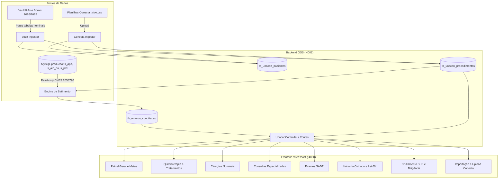

# Módulo Especializado UNACON — Plano de Implementação

> **For agentic workers:** REQUIRED SUB-SKILL: Use superpowers:subagent-driven-development to implement this plan task-by-task. Steps use checkbox (`- [ ]`) syntax for tracking.

**Goal:** Criar o módulo dedicado da UNACON na plataforma OSS, com menu lateral e 8 submenus, persistência relacional de pacientes e procedimentos nominais, ingestão automatizada do Vault e do Conecta, e cruzamento em 4 vias contra a produção oficial do SUS (APAC, AIH e SIA no banco `producao`).

**Architecture:** O módulo organiza a oncologia em linhas de cuidado (Quimioterapia, Cirurgias, Consultas e Exames SADT), extraindo tabelas nominais do Vault e uploads do Conecta para o banco relacional `oss`, enquanto um serviço de auditoria cruza esses registros com o banco MariaDB `producao` (CNES 2058790) classificando o status em 4 vias (*Conciliado*, *Apenas OSS*, *Apenas SUS*, *Divergente*).

**Architecture Diagram:**



**Tech Stack:** Node.js 22, Express 4, Sequelize 6, MySQL 8 / MariaDB, React 19, TypeScript, Vite 8, Tailwind v4, Lucide Icons, Mocha + Chai.

**Spec:** [`docs/superpowers/specs/2026-11-22-modulo-unacon-design.md`](file:///e:/xampp/htdocs/oss/docs/superpowers/specs/2026-11-22-modulo-unacon-design.md)

## Global Constraints

- Backend na porta `:4001`, frontend Vite na porta `:4000`.
- TypeScript strict com zero erros em `cd frontend && npx tsc --noEmit`.
- Testes unitários com Mocha + Chai em `specs/unacon/` (`npx mocha specs/unacon/*.spec.js --exit`).
- Conexão com o banco `producao` é estritamente **read-only** (somente queries `SELECT`).
- Manter integridade de RBAC utilizando `checkPermission('unacon', 'view')`.
- Dados sensíveis de pacientes (LGPD) restritos ao banco e interfaces autenticadas; nunca versionados no Git.

---

### Task 1: Migrações Sequelize e Modelos Relacionais

**Files:**
- Create: `src/db/migrations/20261122140000-create-unacon-tables.js`
- Create: `src/models/UnaconPaciente.js`
- Create: `src/models/UnaconProcedimento.js`
- Create: `src/models/UnaconConciliacao.js`
- Create: `src/models/UnaconUpload.js`
- Modify: `src/models/index.js`
- Test: `specs/unacon/unaconModels.spec.js`

**Interfaces:**
- Produces: Modelos Sequelize `db.UnaconPaciente`, `db.UnaconProcedimento`, `db.UnaconConciliacao`, `db.UnaconUpload`.

- [ ] **Step 1: Escrever o teste para os modelos Sequelize da UNACON**

```javascript
// specs/unacon/unaconModels.spec.js
const { expect } = require('chai');
const db = require('../../src/models');

describe('Modelos Relacionais da UNACON', () => {
  it('deve exportar os modelos UnaconPaciente, UnaconProcedimento, UnaconConciliacao e UnaconUpload', () => {
    expect(db.UnaconPaciente).to.exist;
    expect(db.UnaconProcedimento).to.exist;
    expect(db.UnaconConciliacao).to.exist;
    expect(db.UnaconUpload).to.exist;
  });

  it('deve ter as associações corretas configuradas', () => {
    expect(db.UnaconPaciente.associations.procedimentos).to.exist;
    expect(db.UnaconProcedimento.associations.paciente).to.exist;
    expect(db.UnaconProcedimento.associations.conciliacoes).to.exist;
  });
});
```

- [ ] **Step 2: Executar o teste e verificar a falha**

Run: `npx mocha specs/unacon/unaconModels.spec.js --exit`  
Expected: FAIL com `Cannot read properties of undefined` ou modelo inexistente.

- [ ] **Step 3: Criar a migração Sequelize com as 4 tabelas**

Criar `src/db/migrations/20261122140000-create-unacon-tables.js` contendo:
- `tb_unacon_pacientes` (paciente_id, nome, nome_normalizado, cpf, cns, data_nascimento, idade, prontuario, municipio_origem, criado_em, atualizado_em)
- `tb_unacon_procedimentos` (procedimento_id, paciente_id, competencia, tipo, subtipo, codigo_sigtap, descricao_procedimento, data_solicitacao, data_execucao, dias_ate_inicio, status_lei_60_dias, profissional_nome, especialidade, comparecimento, tipo_agendamento, complexidade, fonte_origem, arquivo_origem, criado_em, atualizado_em)
- `tb_unacon_conciliacao` (conciliacao_id, competencia, procedimento_id, tabela_sus, id_origem_sus, status_conciliacao, paciente_nome_oss, paciente_nome_sus, sigtap_oss, sigtap_sus, data_oss, data_sus, municipio_oss, municipio_sus, divergencia_tipo, divergencia_detalhe, conferido_em)
- `tb_unacon_uploads` (upload_id, nome_arquivo, tipo_fonte, competencia, total_linhas, linhas_processadas, linhas_erros, usuario_id, criado_em)

- [ ] **Step 4: Executar a migração no banco de dados**

Run: `npm run db:migrate`  
Expected: Migração aplicada com sucesso.

- [ ] **Step 5: Criar os arquivos de modelo em `src/models/` e registrar em `src/models/index.js`**

Definir `UnaconPaciente.js`, `UnaconProcedimento.js`, `UnaconConciliacao.js`, `UnaconUpload.js` e suas associações `hasMany` / `belongsTo`.

- [ ] **Step 6: Executar o teste e verificar que passa**

Run: `npx mocha specs/unacon/unaconModels.spec.js --exit`  
Expected: PASS (2 passing).

- [ ] **Step 7: Commit**

```bash
git add src/db/migrations/20261122140000-create-unacon-tables.js src/models/Unacon*.js src/models/index.js specs/unacon/unaconModels.spec.js
git commit -m "feat(unacon): modelos e migracao das tabelas da UNACON"
```

---

### Task 2: Motor de Ingestão de Dados do Vault (RAs e Books)

**Files:**
- Create: `src/incorporacao/unaconVaultIngest.js`
- Test: `specs/unacon/unaconVaultIngest.spec.js`

**Interfaces:**
- Consumes: Arquivos `.md` e `.tables.json` de `prestacao-vault/vault/2026/unacon/*/relatorio_assistencial/`
- Produces: `async function ingerirVaultUnacon({ ano, mes, db })` populando `tb_unacon_pacientes` e `tb_unacon_procedimentos`.

- [ ] **Step 1: Escrever teste unitário para o parser de tabelas nominais do Vault**

```javascript
// specs/unacon/unaconVaultIngest.spec.js
const { expect } = require('chai');
const { parseTabelaCirurgias, parseTabelaConsultas } = require('../../src/incorporacao/unaconVaultIngest');

describe('Parser de Tabelas Nominais do Vault UNACON', () => {
  it('deve extrair campos de cirurgia corretamente', () => {
    const rawMarkdown = `
|QUANT|DATA DA SOLICITAÇÃO|DATA DA CIRURGIA|TEMPO DE EXECUÇAO EM DIAS|PACIENTE|IDADE|CODIGO DO PROCEDIMENTO|PROCEDIMENTO|MÉDICO|TIPO|COMPLEXIDADE|
|1|22/01/2026|01/02/2026|10 DIAS|MARIA DA SILVA|65|0416120059|SEGMENTECTOMIA DE MAMA|DR SILVA|ELETIVA|ALTA|
    `;
    const cirurgias = parseTabelaCirurgias(rawMarkdown);
    expect(cirurgias).to.have.lengthOf(1);
    expect(cirurgias[0].nome).to.equal('MARIA DA SILVA');
    expect(cirurgias[0].diasAteInicio).to.equal(10);
    expect(cirurgias[0].codigoSigtap).to.equal('0416120059');
    expect(cirurgias[0].complexidade).to.equal('alta');
  });

  it('deve extrair campos de consultas e município corretamente', () => {
    const rawMarkdown = `
|QUANT|Data Agenda|Especialidade|Médico|Paciente|Atendido|Aus|Tipo Agendamento|Município|
|1|02/01/2026|ONCOLOGIA CLINICA|DR ADOLFO|JOAO PEREIRA|X||RETORNO|AMERICANA|
    `;
    const consultas = parseTabelaConsultas(rawMarkdown);
    expect(consultas).to.have.lengthOf(1);
    expect(consultas[0].nome).to.equal('JOAO PEREIRA');
    expect(consultas[0].municipio).to.equal('AMERICANA');
    expect(consultas[0].comparecimento).to.equal('atendido');
  });
});
```

- [ ] **Step 2: Executar o teste e verificar a falha**

Run: `npx mocha specs/unacon/unaconVaultIngest.spec.js --exit`  
Expected: FAIL com módulo inexistente.

- [ ] **Step 3: Implementar o script de ingestão e exportação das funções de parse**

Criar `src/incorporacao/unaconVaultIngest.js` com:
- `parseTabelaCirurgias(textoMarkdown)`
- `parseTabelaConsultas(textoMarkdown)`
- `ingerirMesUnacon(ano, mes)`: realiza `findOrCreate` em `tb_unacon_pacientes` e cria os registros em `tb_unacon_procedimentos` associados à competência.
- Suporte a execução CLI: `node src/incorporacao/unaconVaultIngest.js --ano=2026 [--mes=janeiro]`.

- [ ] **Step 4: Executar o teste unitário e verificar que passa**

Run: `npx mocha specs/unacon/unaconVaultIngest.spec.js --exit`  
Expected: PASS.

- [ ] **Step 5: Executar a ingestão piloto de Janeiro/2026**

Run: `node src/incorporacao/unaconVaultIngest.js --ano=2026 --mes=janeiro`  
Expected: Saída indicando cirurgias e consultas de janeiro ingeridas com sucesso.

- [ ] **Step 6: Commit**

```bash
git add src/incorporacao/unaconVaultIngest.js specs/unacon/unaconVaultIngest.spec.js
git commit -m "feat(unacon): motor de ingestao de tabelas nominais do vault"
```

---

### Task 3: Serviço de Conciliação em 4 Vias com MySQL `producao`

**Files:**
- Create: `src/service/UnaconConciliacaoService.js`
- Test: `specs/unacon/unaconConciliacao.spec.js`

**Interfaces:**
- Consumes: `tb_unacon_procedimentos` e tabelas do banco `producao` (`s_apa`, `s_aih_pa`, `s_prd`) via `src/config/producaoDb.js`.
- Produces: `async function conciliarCompetencia(competencia)` gerando registros em `tb_unacon_conciliacao`.

- [ ] **Step 1: Escrever teste unitário para a lógica de classificação em 4 vias**

```javascript
// specs/unacon/unaconConciliacao.spec.js
const { expect } = require('chai');
const { classificarMatch } = require('../../src/service/UnaconConciliacaoService');

describe('Classificação de Conciliação UNACON x SUS', () => {
  it('deve classificar como conciliado quando procedimento e paciente batem no SUS', () => {
    const itemOss = { nome: 'MARIA SILVA', sigtap: '0416120059', municipio: 'AMERICANA' };
    const itemSus = { nome: 'MARIA SILVA', sigtap: '0416120059', municipio: 'AMERICANA' };
    const res = classificarMatch(itemOss, itemSus);
    expect(res.status).to.equal('conciliado');
  });

  it('deve classificar como divergência se município ou procedimento diferirem', () => {
    const itemOss = { nome: 'MARIA SILVA', sigtap: '0416120059', municipio: 'AMERICANA' };
    const itemSus = { nome: 'MARIA SILVA', sigtap: '0416120059', municipio: 'SANTA BARBARA' };
    const res = classificarMatch(itemOss, itemSus);
    expect(res.status).to.equal('divergencia');
    expect(res.tipo).to.equal('municipio_divergente');
  });

  it('deve classificar como apenas_oss quando item não tem registro SUS', () => {
    const res = classificarMatch({ nome: 'MARIA SILVA' }, null);
    expect(res.status).to.equal('apenas_oss');
  });
});
```

- [ ] **Step 2: Executar o teste e verificar a falha**

Run: `npx mocha specs/unacon/unaconConciliacao.spec.js --exit`  
Expected: FAIL.

- [ ] **Step 3: Implementar `UnaconConciliacaoService.js`**

Implementar consultas no banco `producao`:
- APACs de quimioterapia (`s_apa` onde `APA_UID = '2058790' AND APA_CMP = :cmp`)
- AIHs de cirurgia (`s_aih_pa` onde `CNES = '2058790' AND COMPETENCIA = :cmp`)
- Consultas ambulatoriais (`s_prd` onde `prd_uid = '2058790' AND prd_cmp = :cmp`)
- Matching por CPF/CNS e nome normalizado com tolerância fonética/distância.
- Gravação dos resultados em `tb_unacon_conciliacao`.

- [ ] **Step 4: Executar o teste unitário e verificar aprovação**

Run: `npx mocha specs/unacon/unaconConciliacao.spec.js --exit`  
Expected: PASS.

- [ ] **Step 5: Commit**

```bash
git add src/service/UnaconConciliacaoService.js specs/unacon/unaconConciliacao.spec.js
git commit -m "feat(unacon): engine de conciliacao em 4 vias com banco producao"
```

---

### Task 4: Endpoints da API REST e Controller

**Files:**
- Create: `src/controllers/UnaconController.js`
- Create: `src/service/UnaconService.js`
- Create: `src/route/unaconRoute.js`
- Modify: `src/route/index.js`
- Test: `specs/unacon/unaconApi.spec.js`

**Interfaces:**
- Produces: Endpoints `/api/unacon/*` protegidos por autenticação JWT e permissão `unacon:view` / `unacon:edit`.

- [ ] **Step 1: Escrever teste de integração para os endpoints da UNACON**

```javascript
// specs/unacon/unaconApi.spec.js
const { expect } = require('chai');
const sinon = require('sinon');
const unaconService = require('../../src/service/UnaconService');
const unaconController = require('../../src/controllers/UnaconController');

describe('UnaconController', () => {
  it('getDashboard deve retornar totais e metas da UNACON', async () => {
    sinon.stub(unaconService, 'getDashboard').resolves({ totalQuimio: 711, totalCirurgias: 33 });
    const req = { query: { ano: '2026' } };
    const res = { status: sinon.stub().returnsThis(), json: sinon.spy() };

    await unaconController.getDashboard(req, res);
    expect(res.status.calledWith(200)).to.be.true;
    expect(res.json.firstCall.args[0].totalQuimio).to.equal(711);
    unaconService.getDashboard.restore();
  });
});
```

- [ ] **Step 2: Executar o teste e verificar a falha**

Run: `npx mocha specs/unacon/unaconApi.spec.js --exit`  
Expected: FAIL.

- [ ] **Step 3: Implementar `UnaconService.js`, `UnaconController.js` e `unaconRoute.js`**

Implementar as rotas:
- `GET /api/unacon/dashboard`
- `GET /api/unacon/quimioterapia`
- `GET /api/unacon/cirurgias`
- `GET /api/unacon/consultas`
- `GET /api/unacon/exames`
- `GET /api/unacon/linha-cuidado`
- `GET /api/unacon/cruzamento`
- `POST /api/unacon/conciliacao/executar`
- `POST /api/unacon/sincronizar-vault`
- `POST /api/unacon/upload-conecta`
- `GET /api/unacon/exportar-auditoria`

Registrar rota em `src/route/index.js`:
```javascript
const unaconRoute = require('./unaconRoute');
router.use('/unacon', unaconRoute);
```

- [ ] **Step 4: Executar teste e verificar aprovação**

Run: `npx mocha specs/unacon/unaconApi.spec.js --exit`  
Expected: PASS.

- [ ] **Step 5: Commit**

```bash
git add src/controllers/UnaconController.js src/service/UnaconService.js src/route/unaconRoute.js src/route/index.js specs/unacon/unaconApi.spec.js
git commit -m "feat(unacon): rotas de api e controller do modulo unacon"
```

---

### Task 5: Frontend — Navegação, Menu Lateral e Rotas

**Files:**
- Modify: `frontend/src/components/SidebarMenu.tsx`
- Modify: `frontend/src/App.tsx`
- Create: `frontend/src/types/unacon.ts`
- Create: `frontend/src/services/unaconApi.ts`

- [ ] **Step 1: Adicionar tipos TypeScript em `frontend/src/types/unacon.ts`**

Definir interfaces para `UnaconDashboardData`, `UnaconCirurgiaItem`, `UnaconConsultaItem`, `UnaconConciliacaoItem`, `UnaconFiltros`.

- [ ] **Step 2: Criar cliente de API em `frontend/src/services/unaconApi.ts`**

Implementar chamadas tipadas `getUnaconDashboard`, `getUnaconCirurgias`, `getUnaconConsultas`, `getUnaconConciliacao`, `uploadConectaFile`, etc.

- [ ] **Step 3: Configurar o grupo UNACON no `SidebarMenu.tsx`**

Adicionar novo grupo no `MENU_GROUPS`:
```tsx
{
  id: 'unacon',
  label: 'UNACON (Oncologia)',
  icon: <HeartPulse size={20} />,
  subItems: [
    { to: '/unacon/dashboard',      label: 'Painel Geral & Metas',     icon: <LayoutDashboard size={14} />, modulo: 'unacon' },
    { to: '/unacon/quimioterapia',  label: 'Quimioterapia & Trat.',    icon: <Activity size={14} />,        modulo: 'unacon' },
    { to: '/unacon/cirurgias',      label: 'Cirurgias Oncológicas',    icon: <Scissors size={14} />,        modulo: 'unacon' },
    { to: '/unacon/consultas',      label: 'Consultas Especializadas', icon: <Stethoscope size={14} />,    modulo: 'unacon' },
    { to: '/unacon/exames',         label: 'Exames SADT (Tomografia/USG)', icon: <Layers size={14} />,     modulo: 'unacon' },
    { to: '/unacon/linha-cuidado',  label: 'Linha do Cuidado (Lei 60d)', icon: <Clock size={14} />,         modulo: 'unacon' },
    { to: '/unacon/cruzamento',     label: 'Cruzamento SUS & Auditoria', icon: <GitCompareArrows size={14} />, modulo: 'unacon' },
    { to: '/unacon/importacao',     label: 'Importação & Conecta',     icon: <UploadCloud size={14} />,     modulo: 'unacon' },
  ],
}
```

- [ ] **Step 4: Registrar rotas em `frontend/src/App.tsx`**

Adicionar as rotas protegidas sob o módulo `unacon`.

- [ ] **Step 5: Executar type-check do frontend**

Run: `cd frontend && npx tsc --noEmit`  
Expected: Zero erros de compilação.

- [ ] **Step 6: Commit**

```bash
git add frontend/src/components/SidebarMenu.tsx frontend/src/App.tsx frontend/src/types/unacon.ts frontend/src/services/unaconApi.ts
git commit -m "feat(unacon): navegacao, menu lateral e rotas do modulo unacon"
```

---

### Task 6: Frontend — Telas de Painel, Linhas de Cuidado e Consultas

**Files:**
- Create: `frontend/src/pages/Unacon/UnaconDashboardPage.tsx`
- Create: `frontend/src/pages/Unacon/UnaconQuimioPage.tsx`
- Create: `frontend/src/pages/Unacon/UnaconCirurgiasPage.tsx`
- Create: `frontend/src/pages/Unacon/UnaconConsultasPage.tsx`
- Create: `frontend/src/pages/Unacon/UnaconExamesPage.tsx`
- Create: `frontend/src/pages/Unacon/UnaconLinhaCuidadoPage.tsx`

- [ ] **Step 1: Criar `UnaconDashboardPage.tsx`**
  - KPI Cards (Quimioterapia, Cirurgias, SADT, Consultas).
  - Tabela consolidada com metas contratuais e percentuais atingidos.
- [ ] **Step 2: Criar `UnaconCirurgiasPage.tsx`**
  - Grid com lista nominal de cirurgias, tempo de espera em dias, cirurgião, código SIGTAP e indicador de Lei 60 dias.
- [ ] **Step 3: Criar `UnaconConsultasPage.tsx`**
  - Seletor de especialidade (Oncologia Clínica, Mastologia, Urologia, Cirurgia Oncológica, Cabeça/Pescoço).
  - Tabela nominal de agendamentos com status Atendido/Ausente e Município de origem.
- [ ] **Step 4: Criar `UnaconQuimioPage.tsx` e `UnaconExamesPage.tsx`**
  - Acompanhamento de sessões por protocolo e exames de tomografia/ultrassom.
- [ ] **Step 5: Criar `UnaconLinhaCuidadoPage.tsx`**
  - Destaque para o cumprimento da Lei dos 60 dias (casos com mais de 60 dias em destaque de alerta).
  - Taxas de nutrição, psicologia, eventos adversos e internações.
- [ ] **Step 6: Executar type-check**

Run: `cd frontend && npx tsc --noEmit`  
Expected: Zero erros.

- [ ] **Step 7: Commit**

```bash
git add frontend/src/pages/Unacon/Unacon*.tsx
git commit -m "feat(unacon): telas assistenciais e de producao da UNACON"
```

---

### Task 7: Frontend — Telas de Cruzamento SUS e Importação Conecta

**Files:**
- Create: `frontend/src/pages/Unacon/UnaconCruzamentoPage.tsx`
- Create: `frontend/src/pages/Unacon/UnaconImportacaoPage.tsx`

- [ ] **Step 1: Implementar `UnaconCruzamentoPage.tsx`**
  - Filtro por competência e abas de status em 4 vias:
    - *Todos* / *Conciliados (Verde)* / *Apenas OSS (Amarelo)* / *Apenas SUS (Azul)* / *Divergências (Vermelho)*.
  - Tabela comparativa lado a lado: Dados Declarados pela OSS vs. Dados Faturados no SUS.
  - Botão "Exportar Relatório de Auditoria (Excel/CSV)".
  - Botão "Reprocessar Batimento".
- [ ] **Step 2: Implementar `UnaconImportacaoPage.tsx`**
  - Card de Ingestão do Vault com botão "Sincronizar Relatórios do Vault".
  - Zona de upload Drag & Drop para planilhas do Sistema Conecta (`.xlsx`, `.csv`).
  - Histórico de uploads com número de linhas processadas e eventuais erros.
- [ ] **Step 3: Executar type-check**

Run: `cd frontend && npx tsc --noEmit`  
Expected: Zero erros.

- [ ] **Step 4: Commit**

```bash
git add frontend/src/pages/Unacon/UnaconCruzamentoPage.tsx frontend/src/pages/Unacon/UnaconImportacaoPage.tsx
git commit -m "feat(unacon): telas de cruzamento sus em 4 vias e importacao conecta"
```

---

### Task 8: Ingestão Geral do Acervo 2026, Carga Inicial e Verificação E2E

**Files:**
- Modify: `package.json` (adicionar script `npm run unacon:ingest`)
- Modify: `docs/superpowers/plans/2026-11-22-modulo-unacon.md` (checklist final)

- [ ] **Step 1: Adicionar script em `package.json`**

```json
"unacon:ingest": "node src/incorporacao/unaconVaultIngest.js",
"unacon:conciliar": "node -e \"require('./src/service/UnaconConciliacaoService').conciliarTudo()\""
```

- [ ] **Step 2: Executar ingestão completa do Vault para 2026 (Janeiro a Setembro)**

Run: `node src/incorporacao/unaconVaultIngest.js --ano=2026`  
Expected: Ingestão de todos os 9 meses com sucesso, populando `tb_unacon_pacientes` e `tb_unacon_procedimentos`.

- [ ] **Step 3: Executar conciliação inicial contra o banco `producao`**

Run: `npm run unacon:conciliar`  
Expected: Batimento concluído com registros classificados em `tb_unacon_conciliacao`.

- [ ] **Step 4: Executar testes automatizados completos e type-check**

Run: `npx mocha specs/unacon/*.spec.js --exit`  
Run: `cd frontend && npx tsc --noEmit`  
Expected: Todos os testes passando e type-check limpo.

- [ ] **Step 5: Commit final**

```bash
git add package.json docs/superpowers/plans/2026-11-22-modulo-unacon.md
git commit -m "feat(unacon): carga de dados e scripts de integracao unacon"
```
